# Automated Incident Triage & Routing in ServiceNow


-orange)

A no-code **ServiceNow Workflow Studio** flow that automatically triages new incidents. When an incident is created, the flow reads its *Short description*, decides whether it is a **security** or a **standard IT** issue, and assigns the right team and priority, so L1 analysts no longer route tickets by hand.

> Full write-up with every step and screenshot: [`docs/ServiceNow_Incident_Triage_Project_Documentation.pdf`](docs/ServiceNow_Incident_Triage_Project_Documentation.pdf) (Word version: [`.docx`](docs/ServiceNow_Incident_Triage_Project_Documentation.docx))

---

## Table of contents
1. [Problem](#problem)
2. [Solution](#solution)
3. [How it works](#how-it-works)
4. [Build walkthrough](#build-walkthrough)
5. [Test and results](#test-and-results)
6. [Known issues and next steps](#known-issues-and-next-steps)
7. [Repository structure](#repository-structure)
8. [Reproduce it yourself](#reproduce-it-yourself)
9. [What I learned](#what-i-learned)
10. [Author](#author)

---

## Problem
Tier 1 analysts spend a lot of time on repetitive categorisation and assignment. Manual routing is slow and inconsistent, and a security-related ticket can wait in a general queue behind routine requests, which delays Security Operations (SecOps) response.

## Solution
A record-triggered flow on the **Incident** table that:
- fires automatically on every newly created incident,
- checks the Short description for security keywords (`virus`, `malware`, `breach`, `security`, `unauthorized`),
- routes security incidents to **IT Securities** at priority **2 - High**,
- routes everything else to **Service Desk** at priority **3 - Moderate**,
- records every evaluation in the flow execution history for audit.

## How it works
Intended routing logic:

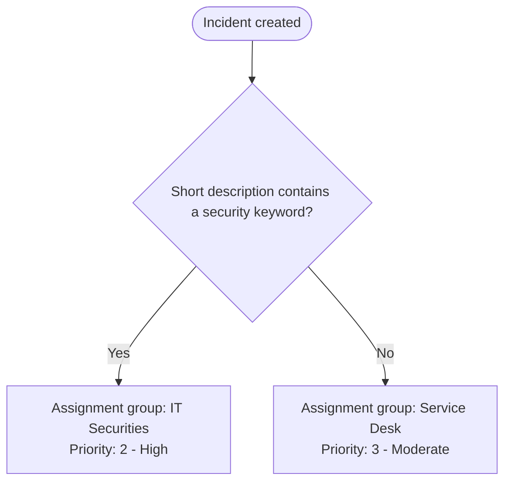

| Condition | Keywords in Short description | Assignment group | Priority |
|---|---|---|---|
| Security | virus, malware, breach, security, unauthorized | IT Securities | 2 - High |
| Standard IT | anything else | Service Desk | 3 - Moderate |

**Environment:** ServiceNow Personal Developer Instance, Workflow Studio, Global scope, trigger = Record > Created on `incident`.

## Build walkthrough

### 1. Provision a developer instance
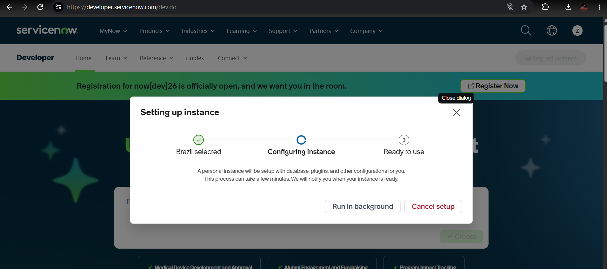

### 2. Create the flow
Name: **L1 IT Support & SOC Incident Triage**, application scope: Global.

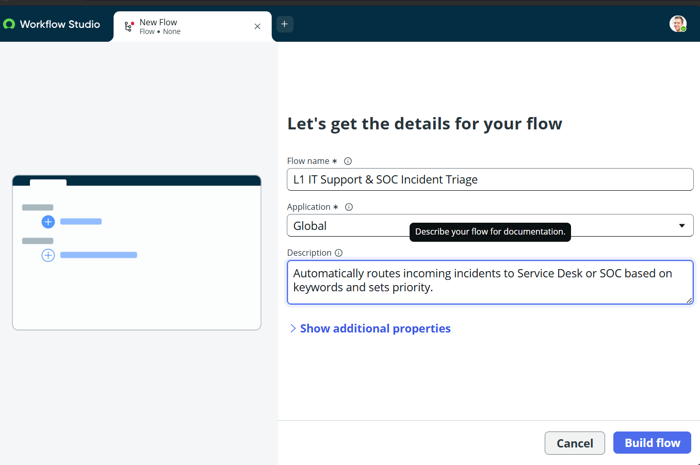

### 3. Configure the trigger
Record trigger, **Created**, on the Incident table.

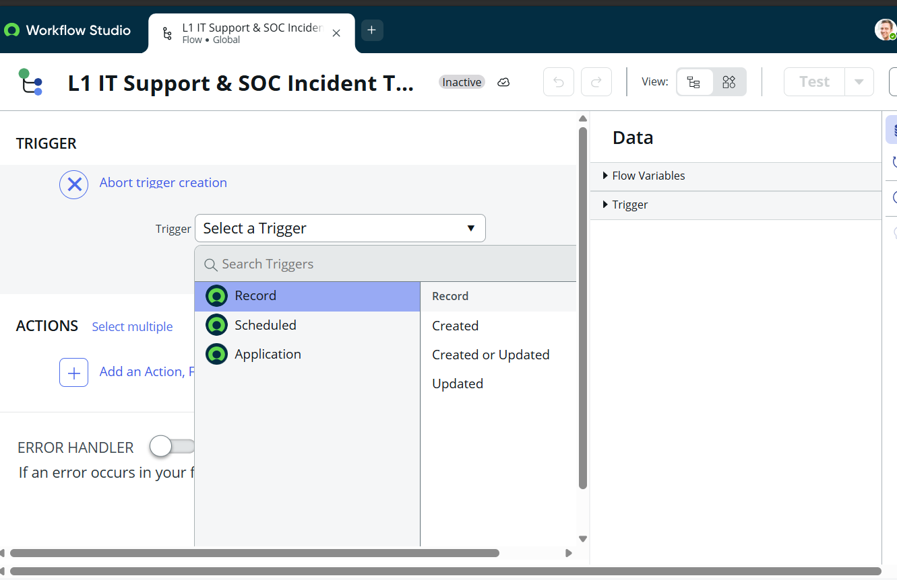

### 4. Add the conditional logic
An **If** block compares the incident Short description with the security keywords.

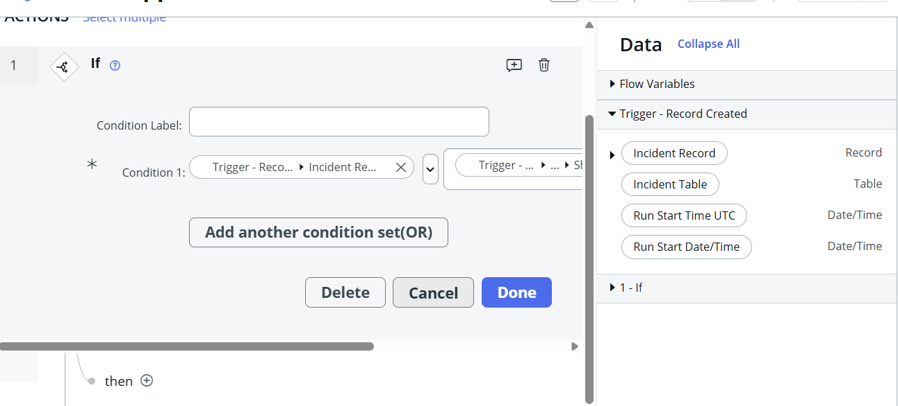
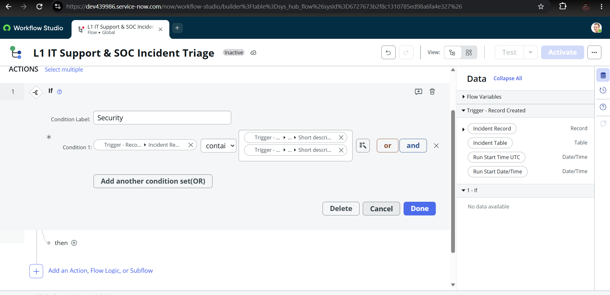

### 5. Security branch action
**Update Record**: Assignment group = IT Securities, Priority = 2 - High.

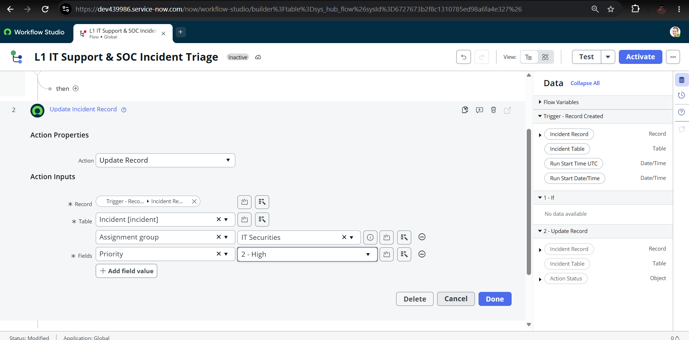

### 6. Standard IT branch actions
**Update Record**: Assignment group = Service Desk, Priority = 3 - Moderate.

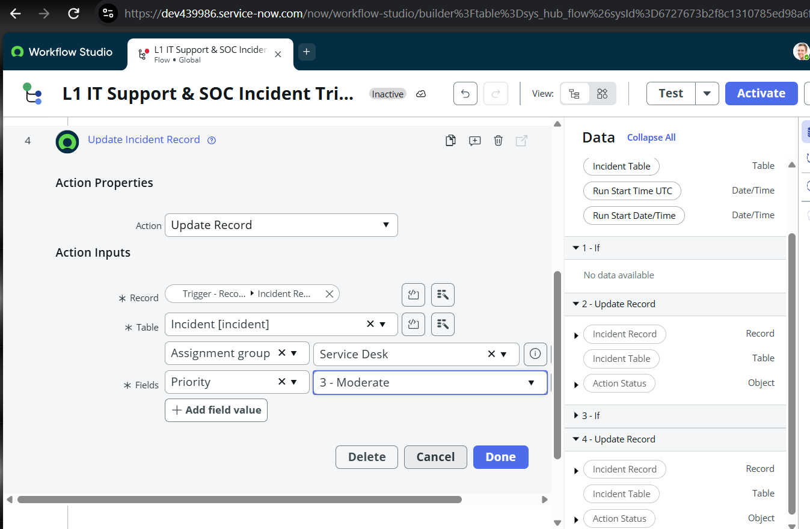
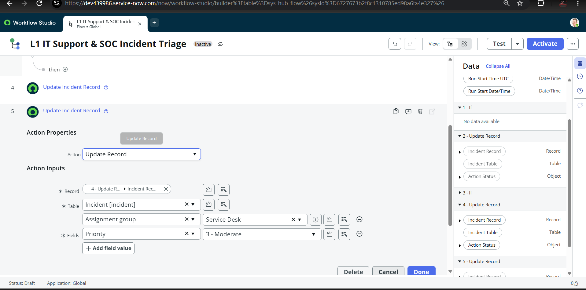

### 7. Complete flow
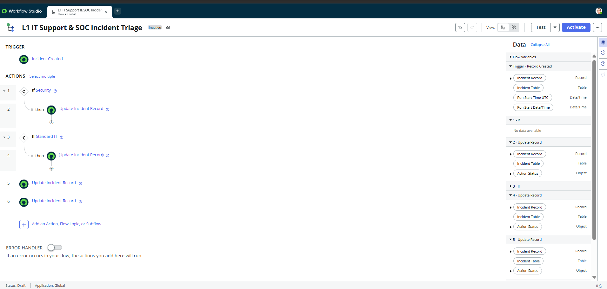

## Test and results
Test incident **INC0010003**, caller David Miller, Short description: *"Unauthorized SSH brute-force security breach"*.

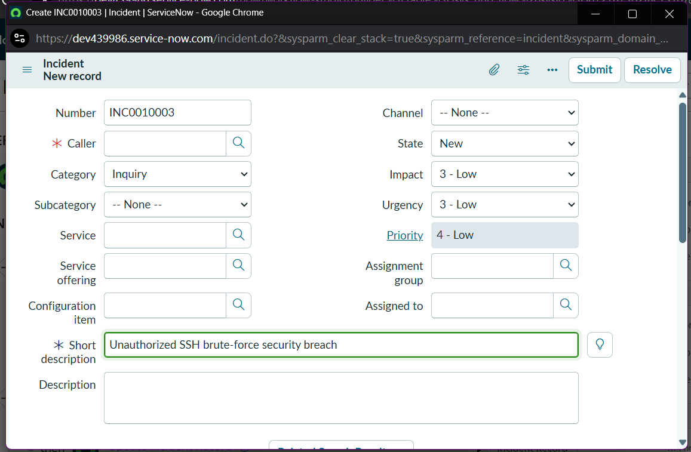
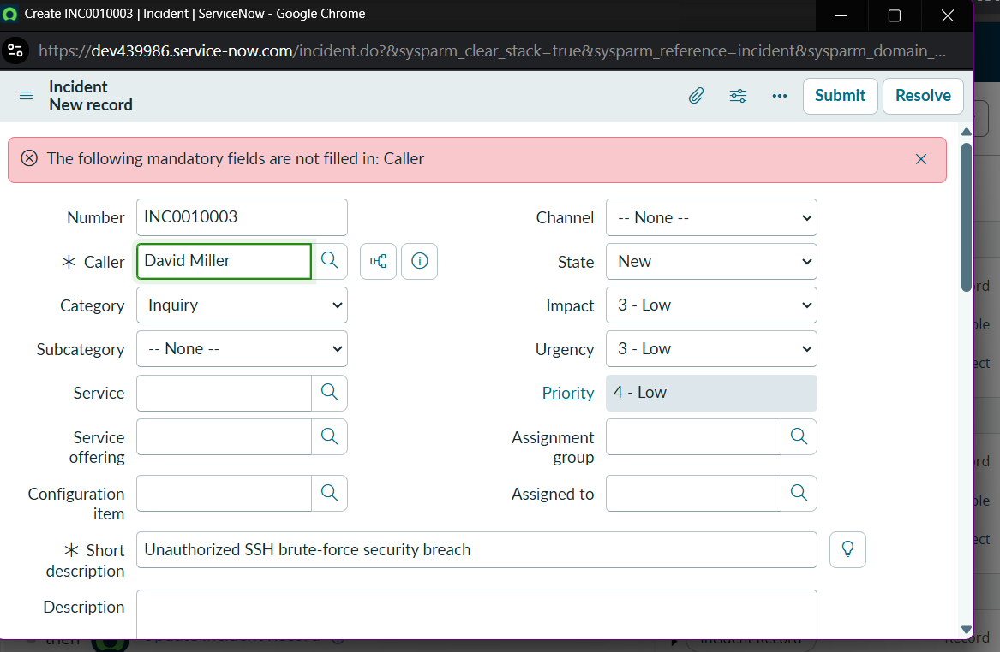
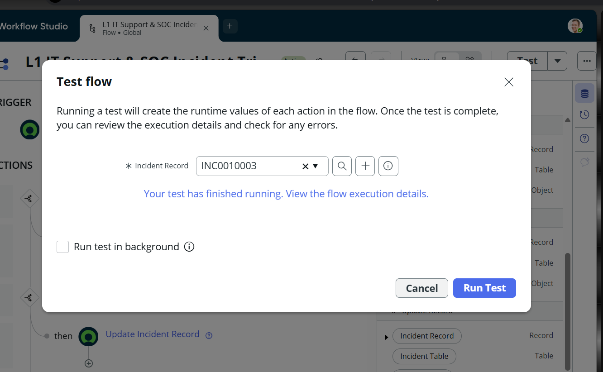
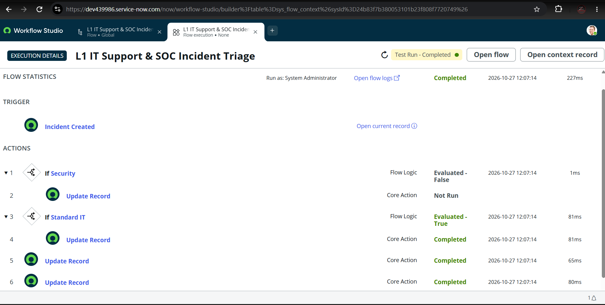

| # | Step | Result | Time |
|---|---|---|---|
| 1 | If Security | Evaluated - False | 1 ms |
| 2 | Update Record (Security branch) | Not Run | - |
| 3 | If Standard IT | Evaluated - True | 81 ms |
| 4 | Update Record (Standard IT branch) | Completed | 81 ms |
| 5 | Update Record | Completed | 65 ms |
| 6 | Update Record | Completed | 80 ms |

**Measured:** the flow triggered automatically and the full run completed in **227 ms** with a complete per-step audit trail.

## Known issues and next steps
In this test run the **Security** condition evaluated **False** even though the Short description contains "Unauthorized", "security" and "breach", so the incident went down the Standard IT path. The intended SOC routing has **not yet been verified**. Likely causes seen in the configuration screenshots:

- The "contains" values in the Security condition appear to be data pills referencing the Short description field, not typed keywords.
- Actions 5 and 6 sit outside both If blocks, so they run on every incident and may overwrite the branch result.

Planned fixes:
- [ ] Use typed keyword values, one OR condition set per keyword
- [ ] Replace the Standard IT If block with an Else branch
- [ ] Move or remove actions 5 and 6
- [ ] Re-test with a security incident and a routine one (e.g. "Printer not working"), then update the screenshots
- [ ] Set Impact/Urgency and State, and add notifications to the assigned group
- [ ] Extend categories (network, access, hardware) and add SLA targets

## Repository structure
```
AutoFix-Desk/
├── README.md
├── docs/
│   ├── ServiceNow_Incident_Triage_Project_Documentation.docx
│   └── ServiceNow_Incident_Triage_Project_Documentation.pdf
└── screenshots/
    ├── 01-developer-instance-provisioning.png
    ├── ...
    └── 13-flow-execution-details.png
```

## Reproduce it yourself
1. Request a free Personal Developer Instance at [developer.servicenow.com](https://developer.servicenow.com).
2. Open **Workflow Studio** and create a flow named *L1 IT Support & SOC Incident Triage* (Global scope).
3. Add the trigger **Record > Created** on the **Incident** table.
4. Add an **If** block (label *Security*) with the keyword conditions, then an **Update Record** action for IT Securities / 2 - High.
5. Add the Standard IT branch with an **Update Record** for Service Desk / 3 - Moderate.
6. Activate the flow, create a test incident, and run **Test** to inspect the execution details.

## What I learned
- How incidents, assignment groups and priority fit together in an ITSM workflow
- Building record-triggered, conditional automation in Workflow Studio without code
- Reading flow execution details to find out why a branch did or did not run, and treating a failed expectation as a bug to document and fix

## Author
**Mohammed Zia Ur Rahman**, aspiring SOC / cybersecurity analyst, Hyderabad, India
- Portfolio: https://mohammedziaurrahmanportfolio.vercel.app/
- GitHub: https://github.com/Zia2691r
